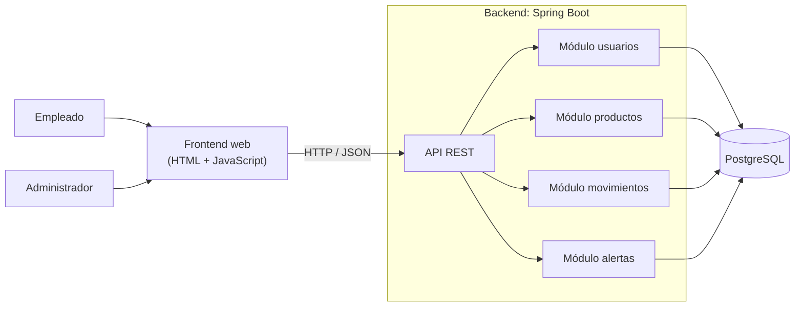
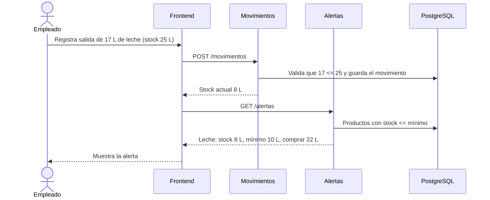

# Arquitectura tecnológica

Versión 0.2 · Sprint 1 · Responsable: Alison (rol E)

## Vista general

El sistema es una aplicación web con tres capas: una interfaz para el usuario, una API REST en Spring Boot y una base de datos PostgreSQL. Los módulos del backend se separan por responsabilidad para que cada integrante trabaje en el suyo sin pisarse con los demás.

## Componentes

| Componente | Responsabilidad | Dueño |
|---|---|---|
| Frontend | 5 pantallas: inicio de sesión, productos y alertas, registro de movimientos, historial con ajustes y gestión de empleados | D · Renata |
| Módulo usuarios | Inicio de sesión, roles Empleado y Administrador, cuenta inicial de administrador, gestión de empleados | A · Alison |
| Módulo productos | Alta, validaciones, desactivar, reactivar y eliminar productos | B · Marco |
| Módulo alertas | Detectar stock igual o inferior al mínimo y sugerir la compra | B · Marco |
| Módulo movimientos | Entradas, salidas, ajustes del administrador, inventario inicial e historial | C · Antonio |
| PostgreSQL | Guarda usuarios, productos y movimientos | Compartido |
| Docker | Levanta la base de datos y el backend (con la interfaz web incluida) con un comando | E · Alison |

En el Sprint 1 están implementados el módulo de usuarios, la seguridad y Docker (Alison). Los módulos de productos, alertas, movimientos y el frontend los implementa cada dueño en su propia rama (ver [sprints/sprint-01.md](sprints/sprint-01.md)).

## Flujo de ejemplo: alerta de stock bajo en una cafetería

Las rutas reales están en [api.md](api.md).

## Decisiones de diseño relevantes

- Las alertas **se calculan** a partir del stock y del mínimo; no se guardan. Propuesta de diseño; la decisión final y su ADR quedan a cargo de B · Marco.
- Cada módulo vive en su propio paquete y tiene su propia migración de base de datos para evitar choques entre integrantes.
- El stock actual de un producto se actualiza en la misma transacción que registra el movimiento (decisión por confirmar entre B y C).

## Pendientes

- Migrar el frontend a un framework solo si sobra tiempo (ver [stack-tecnologico.md](stack-tecnologico.md)).
- Confirmar con el equipo el comportamiento de las alertas en los casos límite (a cargo de B · Marco).
