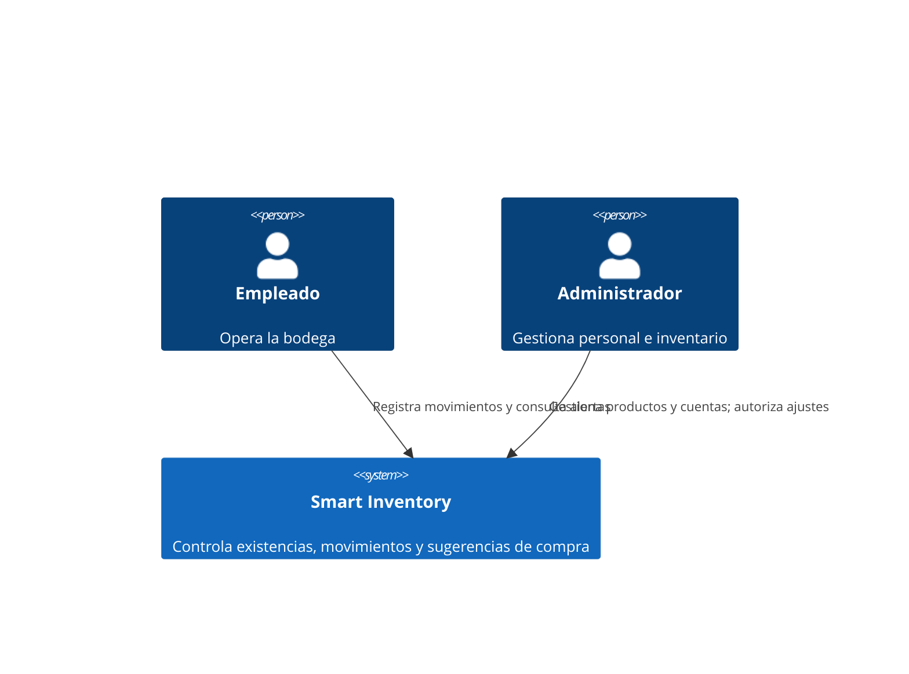
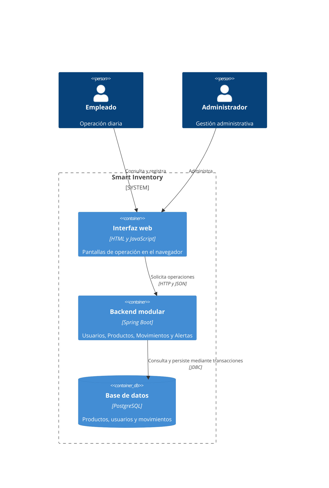

# Smart Inventory · Visión y diseño del MVP

Responsable de documentación: Marco Bonilla, rol B. Alcance: MVP del repositorio grupal para una cafetería, restaurante o tienda. El backlog expresa resultados esperados; la integración con PostgreSQL y Movimientos sigue pendiente de verificación.

## Visión del producto

El personal necesita saber cuánto queda después de cada entrada y salida para decidir cuándo reponer. Smart Inventory reúne los movimientos y el catálogo en una aplicación web. El empleado consulta existencias, registra movimientos y revisa alertas. El administrador también mantiene productos, gestiona cuentas y corrige saldos mediante ajustes trazables.

El MVP abarca acceso por roles, catálogo, entradas y salidas, ajustes, historial y sugerencias de compra. La plataforma integral prevista en el deber incluye además lotes y ubicaciones, FEFO, compras, flota y analítica. Una sugerencia del MVP informa al usuario; la aprobación de órdenes corresponde a una ampliación posterior.

## Épicas e historias priorizadas

|Orden / historia|Épica y usuario|Resultado esperado|Criterio de aceptación|Responsable técnico|
|---|---|---|---|---|
|1 · HU01|Acceso · administrador|Crear cuentas de empleado para operar con identidad propia.|Un empleado autenticado consulta el catálogo y recibe 403 al intentar crear productos.|A|
|2 · HU02|Catálogo · administrador|Registrar y editar nombre y parámetros de reposición.|El producto inicia activo con stock cero. Objetivo igual o inferior al mínimo devuelve 400.|B|
|3 · HU03|Inventario · empleado|Registrar entradas y salidas para mantener el saldo.|Tras ingresar 25 L y sacar 17 L, quedan 8 L y ambos movimientos figuran en el historial.|C|
|4 · HU04|Reposición · empleado|Saber qué producto reponer y cuánto comprar.|Con mínimo 10 L y objetivo 30 L, a 10 L se sugieren 20 L; a 8 L, 22 L; a 11 L desaparece la alerta.|B|
|5 · HU05|Catálogo · administrador|Retirar temporalmente un producto y reactivarlo.|Desactivarlo conserva su historial y lo excluye de alertas. Reactivarlo vuelve a evaluar el saldo.|B, coordinación con C|
|6 · HU06|Catálogo · administrador|Eliminar productos cargados por error.|Un producto sin stock ni movimientos se elimina. Si tiene historial, incluso con saldo cero, la operación debe devolver 409.|B y C|
|7 · HU07|Inventario · administrador|Corregir diferencias y rastrear su origen.|Un ajuste conserva motivo y saldo resultante. El historial permite filtrar por producto y fecha.|C|
|8 · HU08|Interfaz · empleado|Consultar productos y alertas desde la misma pantalla.|La vista presenta nombre, unidad, saldo y cantidad sugerida conforme a la respuesta del backend.|D|

## Límites y propiedad de datos

|Módulo|Datos que controla|Interacción permitida|
|---|---|---|
|Usuarios|Identidad, rol y estado de cuentas|Seguridad consulta el rol antes de permitir operaciones administrativas.|
|Productos|Identidad, nombre, unidad, activo, mínimo y objetivo|Crea el producto con saldo inicial cero. Editar el catálogo conserva el saldo operativo.|
|Movimientos|Entradas, salidas, ajustes, historial y cambios de saldo operativo|Actualiza el saldo junto al movimiento en una transacción. La columna stock reside físicamente en productos.|
|Alertas|Regla de cálculo y resultado de consulta|Lee estado, mínimo, objetivo y saldo. Calcula al consultar, sin guardar ni modificar stock.|
|Interfaz|Presentación y selección del usuario|Envía acciones al módulo responsable y muestra sus resultados.|

Acuerdo de integración por confirmar con C: cada movimiento referencia el producto con una clave foránea que impide eliminarlo mientras exista historial. Un saldo cero por sí solo no acredita que el producto nunca se haya utilizado.

## C4 · Nivel 1 · Contexto

## C4 · Nivel 2 · Contenedores

La interfaz puede distribuirse dentro del proyecto Spring Boot y ejecutarse en el navegador. Productos, Movimientos y Alertas son módulos internos del mismo backend. Si aumenta la carga de consultas, Alertas podría extraerse usando una vista de lectura alimentada por cambios confirmados de saldo y catálogo.
