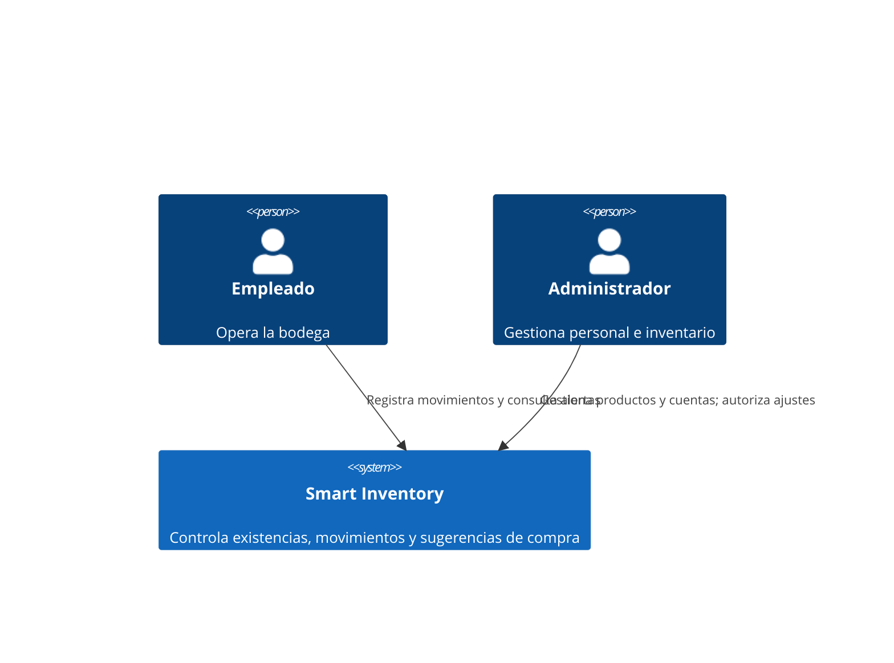
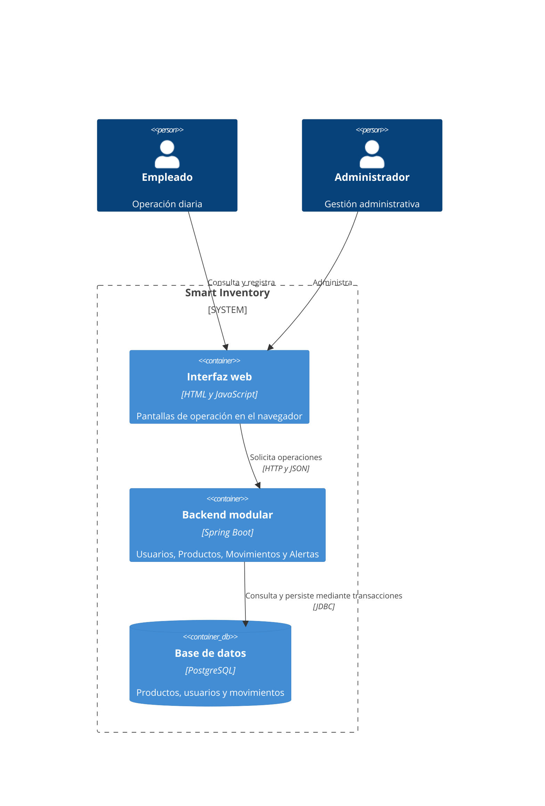

# Smart Inventory · Visión y diseño del MVP

Responsable de documentación: Marco Bonilla, rol B. Alcance: MVP del repositorio grupal para una cafetería, restaurante o tienda. El backlog expresa resultados esperados; la integración con PostgreSQL y Movimientos sigue pendiente de verificación.

## Visión del producto

El personal necesita saber cuánto queda después de cada entrada y salida para decidir cuándo reponer. Smart Inventory reúne los movimientos y el catálogo en una aplicación web. El empleado consulta existencias, registra movimientos y revisa alertas. El administrador también mantiene productos, gestiona cuentas y corrige saldos mediante ajustes trazables.

El MVP abarca acceso por roles, catálogo, entradas y salidas, ajustes, historial y sugerencias de compra. La plataforma integral prevista en el deber incluye además lotes y ubicaciones, FEFO, compras, flota y analítica. Una sugerencia del MVP informa al usuario; la aprobación de órdenes corresponde a una ampliación posterior.

## Épicas e historias priorizadas

|Orden / historia|Épica y usuario|Resultado esperado|Criterio de aceptación|Responsable técnico|
|---|---|---|---|---|
|1 · HU01|Acceso · administrador|Crear cuentas de empleado para operar con identidad propia.|Un empleado autenticado consulta el catálogo y recibe 403 al intentar crear productos.|A|
|2 · HU02|Catálogo · administrador|Registrar y editar nombre y parámetros de reposición.|El producto inicia activo con stock cero. Objetivo igual o inferior al mínimo devuelve 400.|B|
|3 · HU03|Inventario · empleado|Registrar entradas y salidas para mantener el saldo.|Tras ingresar 25 L y sacar 17 L, quedan 8 L y ambos movimientos figuran en el historial.|C|
|4 · HU04|Reposición · empleado|Saber qué producto reponer y cuánto comprar.|Con mínimo 10 L y objetivo 30 L, a 10 L se sugieren 20 L; a 8 L, 22 L; a 11 L desaparece la alerta.|B|
|5 · HU05|Catálogo · administrador|Retirar temporalmente un producto y reactivarlo.|Desactivarlo conserva su historial y lo excluye de alertas. Reactivarlo vuelve a evaluar el saldo.|B, coordinación con C|
|6 · HU06|Catálogo · administrador|Eliminar productos cargados por error.|Un producto sin stock ni movimientos se elimina. Si tiene historial, incluso con saldo cero, la operación debe devolver 409.|B y C|
|7 · HU07|Inventario · administrador|Corregir diferencias y rastrear su origen.|Un ajuste conserva motivo y saldo resultante. El historial permite filtrar por producto y fecha.|C|
|8 · HU08|Interfaz · empleado|Consultar productos y alertas desde la misma pantalla.|La vista presenta nombre, unidad, saldo y cantidad sugerida conforme a la respuesta del backend.|D|

## Límites y propiedad de datos

|Módulo|Datos que controla|Interacción permitida|
|---|---|---|
|Usuarios|Identidad, rol y estado de cuentas|Seguridad consulta el rol antes de permitir operaciones administrativas.|
|Productos|Identidad, nombre, unidad, activo, mínimo y objetivo|Crea el producto con saldo inicial cero. Editar el catálogo conserva el saldo operativo.|
|Movimientos|Entradas, salidas, ajustes, historial y cambios de saldo operativo|Actualiza el saldo junto al movimiento en una transacción. La columna stock reside físicamente en productos.|
|Alertas|Regla de cálculo y resultado de consulta|Lee estado, mínimo, objetivo y saldo. Calcula al consultar, sin guardar ni modificar stock.|
|Interfaz|Presentación y selección del usuario|Envía acciones al módulo responsable y muestra sus resultados.|

Acuerdo de integración por confirmar con C: cada movimiento referencia el producto con una clave foránea que impide eliminarlo mientras exista historial. Un saldo cero por sí solo no acredita que el producto nunca se haya utilizado.

## Backlog de evolución de la plataforma

Las historias HU09–HU16 están propuestas para después del MVP. El orden indica prioridad dentro de esta ampliación. Los ejemplos usan el mismo producto para seguir las cantidades desde la recepción hasta el despacho.

|Orden / historia|Épica y usuario|Resultado esperado|Criterio de aceptación|
|---|---|---|---|
|9 · HU09|Catálogo · administrador|Identificar cada SKU y ubicación de bodega.|Se registran A-01 y B-01 como ubicaciones distintas. Un código ya utilizado en la misma bodega se rechaza.|
|10 · HU10|Inventario · bodeguero|Recibir un producto por lote, ubicación y vencimiento.|Al recibir 12 unidades del lote A en A-01 y 8 del B en B-01 quedan dos saldos y 20 unidades físicas. Una ubicación desconocida impide confirmar el ingreso.|
|11 · HU11|Pedidos · preparador|Reservar primero las unidades aptas que vencen antes (FEFO).|Si A vence antes que B y ambos están vigentes, un pedido de 14 reserva 12 de A y 2 de B. Quedan 20 físicas y 6 disponibles. Si se solicitan 21 al inicio, la reserva completa se rechaza sin alterar saldos.|
|12 · HU12|Reposición y compras · comprador|Aprobar una sugerencia basada en la disponibilidad tras la reserva.|Con 6 disponibles, mínimo 10 y objetivo 20 se sugieren 14. Aprobar dos veces la misma sugerencia genera una sola orden por 14. El saldo físico aumenta cuando se recibe la mercancía.|
|13 · HU13|Flota · coordinador|Asignar robot móvil autónomo (AMR), camión y muelle a la preparación y salida.|Si el muelle está ocupado, la tarea queda pendiente de asignación. Al liberarlo se vinculan los recursos al pedido y se registra el progreso del traslado.|
|14 · HU14|Despacho · encargado de salida|Cerrar el pedido cuando se confirme la salida física.|La salida consume las 14 unidades reservadas: quedan 6 físicas, 0 reservadas y 6 disponibles. Repetir la confirmación conserva esos saldos.|
|15 · HU15|Dashboard · supervisor|Consultar la planta interna y el patio exterior durante el despacho.|La planta interna muestra la ubicación del AMR; la externa muestra camión y muelle asignados. Cada vista indica cuándo recibió su última actualización.|
|16 · HU16|Analítica · supervisor|Identificar vencimientos próximos e interpretar la evolución del stock.|Al elegir una bodega y un período, el reporte identifica lotes con saldo cuyo vencimiento cae en ese intervalo y permite consultar las entradas y salidas del SKU.|

## Límites y propiedad de datos en la arquitectura futura

Estos límites expresan quién puede modificar cada dato aunque varios módulos compartan un despliegue. En el MVP, Productos almacena el mínimo y el objetivo. Si se separa Reposición, esos parámetros se trasladarán a su módulo y el catálogo conservará los datos maestros del producto.

|Capacidad|Datos que puede modificar|Cómo colaboran las demás capacidades|Historias|
|---|---|---|---|
|Catálogo y ubicaciones|SKU, unidad, bodega, zona y ubicación maestra.|Inventario valida referencias antes de registrar la recepción.|HU09–10|
|Inventario|Lote, vencimiento, saldo por lote y ubicación, movimientos y asignación de unidades a una reserva.|Pedidos solicita reservar. Inventario selecciona lotes aptos, confirma cantidades y consume la reserva al despachar.|HU10–11, HU14|
|Pedidos y preparación|Pedido, líneas, estado comercial y tarea de preparación.|Guarda la referencia de la reserva confirmada por Inventario y solicita el traslado a Flota.|HU11, HU13–14|
|Reposición y compras|Mínimos, objetivos, sugerencias, aprobaciones y órdenes de compra.|Evalúa el disponible comunicado por Inventario. La recepción posterior se registra en Inventario con referencia a la orden.|HU12|
|Flota y muelles|AMR, camión, ruta, ocupación de muelle, tarea de traslado y telemetría.|Comunica avance y salida. Pedidos coordina con Inventario el consumo de la reserva.|HU13–15|
|Dashboard|Proyección de planta, estado visible y marcas de actualización.|Combina los cambios de Inventario, Compras, Pedidos y Flota. Una aprobación realizada desde la pantalla se envía a Compras.|HU12, HU15|
|Analítica|Históricos derivados, agregaciones e indicadores.|Procesa movimientos confirmados para reconstruir tendencias y estimar riesgos de vencimiento.|HU16|

## C4 · Nivel 1 · Contexto

## C4 · Nivel 2 · Contenedores

La interfaz puede distribuirse dentro del proyecto Spring Boot y ejecutarse en el navegador. Productos, Movimientos y Alertas son módulos internos del mismo backend. Si aumenta la carga de consultas, Alertas podría extraerse usando una vista de lectura alimentada por cambios confirmados de saldo y catálogo.
